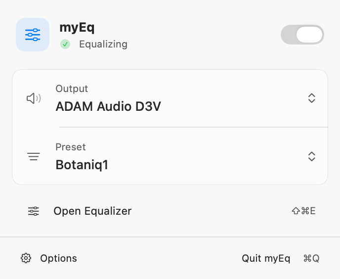
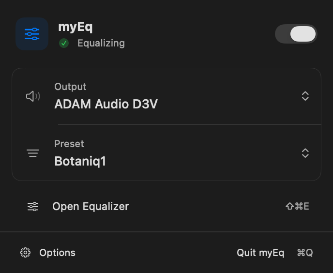

# myEq

[](https://github.com/tcholewa/myEq/actions/workflows/ci.yml)

myEq began with a practical problem: desk speakers that sounded boomy. Room measurements revealed problems at specific frequencies, but macOS had no built-in system-wide equalizer to apply targeted corrections across all audio playback. The idea was to build a small app that could improve the sound of the whole system, with precise frequency adjustments and quick access from the menu bar.

**All code in this project was generated using GPT-6 Astra.**

A native macOS menu bar equalizer for your system's mixed stereo output. Shape your sound with eight parametric bands, save presets, and keep playback running when the editor is closed.

**Apple Silicon · macOS 27+ · MIT licensed**

## Screenshots

**Equalizer window**


**Menu bar**




Menu previews are rendered from source; native popover chrome and wallpaper vibrancy are not shown.

## Features

- Eight bands with bell, low/high shelf, and low/high cut filters; edit frequency, gain, and width numerically, with faders, or on the response graph.
- Saved presets, automatic preamp, and stereo-linked sample-peak protection.
- Independent L/R output meters with slowly falling peak markers and matching dBFS readings, updated at 30 Hz.
- Menu bar access to output selection, presets, bypass, launch at login, and the editor.
- Visual processing pauses when the editor is closed, hidden, minimized, or fully covered; audio processing continues.
- Local audio processing through an output-only virtual device and shared memory. No audio recording, microphone capture, or network audio transport.

myEq processes the default system mix. It does not provide per-app controls; applications explicitly routed to another device remain outside that mix.

## Requirements and project status

| Requirement | Current support |
| --- | --- |
| Mac | Apple Silicon (arm64) |
| macOS | 27 or later |
| Build tools | Full Xcode 27 or later, with its command-line tools selected; Python 3 |
| Installation | Administrator access for the virtual output driver and background helpers |
| Dependencies | Apple system frameworks; no external package dependencies |

This is an early source release. The build produces an **ad-hoc-signed, non-notarized installer** for local development; it is not a Developer ID distribution. Automated checks and some live checks have passed, but the full device, recovery, performance, and latency matrix is still incomplete. See [verification results and remaining hardware checks](docs/VERIFICATION.md).

## Build and install

Clone and build the repository:

```sh
git clone https://github.com/tcholewa/myEq.git
cd myEq
bash scripts/build-installer.sh
python3 scripts/verify-installer.py
open dist/myEq.pkg
```

**Quit myEq and audio playback apps before installing.** The installer reloads Core Audio, briefly interrupting all sound, including calls and recordings. No full Mac restart is required. Reopen playback apps after installation so they reconnect to the audio service.

Open `/Applications/myEq.app` and allow its background helper in **System Settings → General → Login Items & Extensions** if prompted. Select your physical output in myEq, then enable EQ.

Always install the app, driver, and helpers from the same package. Build artifacts are under `build/artifacts.noindex`; `dist/myEq.pkg` is the installer. For setup details, troubleshooting, rollback, and removal, see [installation guide](docs/INSTALLATION.md).

## Use

1. Choose your physical speakers or headphones using **Output** in myEq, then enable EQ. myEq redirects the default media and system-sound mix through its virtual output, named **myEq: {physical output name}** in macOS (for example, **myEq: ADAM Audio D3V**). The name follows output changes and returns to **myEq** when no session is attached.
2. Start with **Flat**, or **Botaniq1** for the seven reference bands. The eighth band is initially disabled. Edit numeric fields, faders, or graph points; save personal presets with **Save preset**. The editor starts with no band selected; clicking outside a band clears its highlight and field focus. Double-click a gain fader or width dial to reset it; exact values remain directly editable. The preset’s **…** menu contains rename, update, restore, and delete actions.
3. Closing or hiding the window keeps audio processing active. The menu bar opens a compact panel with status, a native EQ switch, output and preset selectors, and **Open Equalizer**. **Options** contains launch at login and Audio Setup. The panel follows system light/dark appearance; see the [menu design specification](docs/MENU-DESIGN.md). ⌘⇧E opens the editor from the panel; ⌘E toggles EQ and ⌘0 selects Flat in the editor.
4. Selecting a physical output in macOS bypasses EQ. If the current destination disconnects, myEq follows an available physical fallback and resumes when supported. It does not automatically switch back when the disconnected device returns.

Volume and mute follow the physical device where supported. Fixed-volume hardware remains fixed-volume; myEq never forces the hardware to full volume or applies the same attenuation twice. Quit eqMac before using myEq to avoid competing virtual-output routing.

The independent L/R output meters refresh at **30 Hz**, retain short transients, and measure after EQ and peak protection. Bars fall at 24 dB/second. White peak markers and their matching dBFS readings hold for one second, then fall together at 6 dB/second. Native layers avoid repeated SwiftUI layout. When the editor is hidden, minimized, closed, or fully occluded, visual polling, DSP peak measurement, and the editor’s response calculations stop. Opening only the menu computes no response curves and does not enable live metering. When both surfaces are hidden, all visual calculations stop.

## Output compatibility

Built-in/wired, USB/HDMI, and Bluetooth stereo routes are supported by the implementation. Bluetooth microphone use suspends EQ until stereo playback returns. AirPlay, other virtual devices, aggregates/multi-output, and surround are excluded. The virtual device follows the physical nominal sample rate from 32–192 kHz; unsupported formats remain bypassed. Implementation support is not a claim that every device has been tested; hardware coverage is listed in [verification](docs/VERIFICATION.md).

## Development and contributing

Start with [CONTRIBUTING.md](CONTRIBUTING.md) for the development workflow, checks, and issue reporting. Open `myEq.xcodeproj` for editor work. The packaged app's `--preview` mode opens the editor without enabling audio or saving settings; `--diagnose` prints output-device information.

- [Installation and troubleshooting](docs/INSTALLATION.md): setup, driver loading, recovery, and removal.
- [Architecture](docs/ARCHITECTURE.md): signal path, driver, transport, DSP, and recovery.
- [Verification](docs/VERIFICATION.md): automated results, live evidence, and outstanding checks.
- [Security reporting](SECURITY.md): how to report a vulnerability privately.
- [Maintainer release guide](docs/RELEASING.md): GitHub setup and release preparation.

Peak protection is a stereo-linked sample-peak limiter with 1 ms lookahead, not oversampled true-peak limiting. Hardware buffers, transport, and clock conversion add latency; the under-20-ms wired target still needs end-to-end measurement.

Security hardening and its test limits are documented in the [security review](docs/SECURITY-REVIEW.md). Developer ID candidate tooling is available in the [release guide](docs/RELEASING.md); default source builds remain ad-hoc signed and unnotarized.

## License and acknowledgments

myEq's original code and documentation are licensed under the [MIT License](LICENSE). Copyright © 2026 Tomasz Cholewa.

The DSP's biquad coefficient equations are based on Robert Bristow-Johnson's **Audio EQ Cookbook**, as published by W3C and edited by Raymond Toy. See [third-party acknowledgments and notices](THIRD_PARTY_NOTICES.md) for the source, adaptation details, and W3C license. The build includes both notice files in `myEq.app/Contents/Resources`; in Finder, choose **Show Package Contents** to read them.
